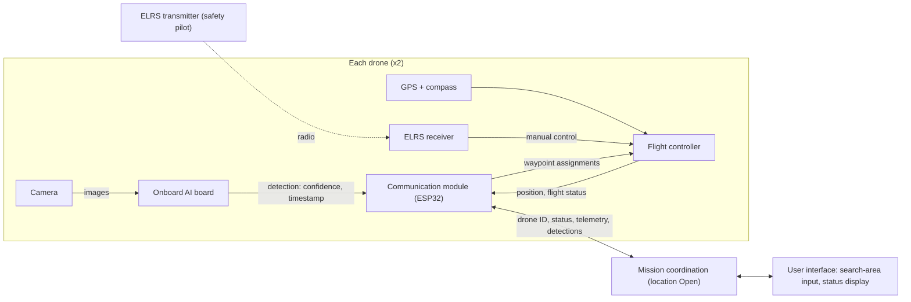

# SAFE-Swarm System Architecture

**Stage:** concept. Nothing on this page has been built or tested yet.
**Last updated:** October 12, 2026
**Sources:** the [project proposal](EECS%20159%20-%20Project%20Proposal.pdf) (uploaded October 12, 2026),
the team's planning discussion, the October 10 revised parts list (flight authorization only),
and general hardware and regulation knowledge.

Items are tagged where a source applies:

- **Proposal**: stated in the current proposal.
- **Discussed**: from planning discussion, not in the proposal. Confirm with the team.
- **General knowledge**: a fact about hardware, software, or rules that isn't in any project document. Double-check it.
- **Open**: not decided. Needs a team decision, an advisor answer, or a test.

Untagged text, such as the diagram layout, the example messages, and the "Who decides" column, is the author's suggestion.

## What the system must do

1. Accept a search area entered by a user. (Proposal)
2. Divide the area into one search route per drone. (Proposal)
3. Fly each route with a flight controller. (Proposal)
4. Detect people in camera images using AI running on the drone. (Proposal)
5. Exchange mission status and detection reports. (Proposal)
6. Demonstrate two-drone search coordination and reporting of detected humans, subject to flight readiness. (Proposal, Winter)

## Aircraft

The proposal plans two drones: one "IKEA-style" drone and one custom drone.

| | Drone 1: IKEA-style (Phase 1) | Drone 2: Custom (Phase 2) |
|---|---|---|
| Goal | Fly early with off-the-shelf parts | Compact design on a custom circuit board (PCBA) |
| Flight controller | The proposal names "PixHawk and Ardupilot" (Proposal). Exact board: Open | Custom STM32F405 board. It is in the proposal's parts table; placing it on Drone 2 is an inference from Phase 2 |
| AI compute | NUCLEO-N657X0-Q development board for early vision work (Proposal). Whether it flies on Drone 1: Open | Built into the custom design (Proposal). Details: Open |
| Budget in proposal text | About $250 | About $200 |

Parts listed per drone in the proposal's rough parts table (Proposal):
custom STM32F405 flight controller, 4-in-1 35 A ESC, four 2004/2000KV brushless
motors, 5–6 inch propellers, BN-880 GPS and compass, ESP32-CAM (OV2640), ESP32
communication module, 4S 3000mAh Li-ion battery, ELRS receiver, wiring, and a
3D-printed frame. One ELRS transmitter is shared.

The proposal's Phase 1 budget line says "(part breakdown below)", pointing to this
table, but the table lists a custom flight controller rather than a PixHawk.
See open question 7.

Terms:

- **ArduPilot**: open-source flight software. It stabilizes the aircraft and flies waypoint missions.
- **ELRS (ExpressLRS)**: a radio control link. With the flight controller set up for it, a person holding the transmitter can take over or disarm the drone. (General knowledge)
- **ESC**: electronic speed controller. It drives the motors.

## Data flow

This diagram shows what information moves where. It is **not** a wiring diagram.
Which boards physically connect to which is still Open.



## Interfaces

| From | To | Data | Status |
|---|---|---|---|
| Camera | AI board | Images | Open: how ESP32-CAM images reach the STM32N6 board (see Open questions) |
| AI board | Mission/communication software | Detection confidence and timestamp | Proposal (Week 8) |
| Flight controller | Mission/communication software | Position and flight status | Proposal (telemetry and position); the exact fields are Discussed |
| Mission software | Flight controller | Waypoint assignments | Proposal |
| Wireless link | Drones and mission coordination | Drone IDs, status, telemetry, detection reports | Proposal (message contents); where mission coordination runs is Open |
| ELRS transmitter | ELRS receiver | Manual control by a safety pilot | Proposal (the parts); the safety-pilot role is General knowledge |

### Detection reports

A detection report says "drone N saw a person with this confidence at this time."
It can include where the **drone** was at that moment.
The drone's position is **not** the person's exact location on the ground.
Estimating the person's location would also need the camera's angle and field of view,
the drone's altitude and tilt, and where the person appears in the image. (General knowledge)
That is not in the current proposal.

Suggested split (Discussed; the proposal's Week 8 matches it, but Phase 2 still lists the task as joint):

- **Devin** produces each detection with its confidence and timestamp.
- **Aaron** associates each detection with available drone-position data, logs the report, and sends it.
- Both collaborate on the interface between the two.

### Example messages (illustrative only)

These show the kind of fields involved. They are **not** the final format.

```json
{"type": "telemetry", "drone_id": 1, "mission_status": "searching", "latitude": 33.6405, "longitude": -117.8443}
```

```json
{"type": "detection", "drone_id": 1, "confidence": 0.87, "timestamp_ms": 123456}
```

Before these become real, the team needs to define:

- Units for every field (for example, degrees, meters, milliseconds).
- What a timestamp counts from (drone boot, GPS time, or another clock).
- Coordinate conventions (latitude/longitude, altitude reference).
- How often each message is sent.
- The transport (radio link) and its message size limit.

ArduPilot already sends and receives commands and telemetry using **MAVLink**, a
standard drone message protocol. Software that talks to an ArduPilot flight
controller will almost certainly use MAVLink. (General knowledge) Whether
drone-to-drone and detection messages also use MAVLink, or a separate format, is Open.

## Open questions

| # | Question | Who decides |
|---|---|---|
| 1 | Where does mission coordination run: a ground laptop, or a board on each drone? | Devin, Aaron, with hardware |
| 2 | How do camera images reach the STM32N6? The proposal's hardware Week 3 already plans to order "STM32N6 devboard and camera"; which camera is not stated. The ESP32-CAM's camera is wired to its own ESP32 chip, so its images would have to be sent to the N6 over a link the team builds. ST's N6 object-detection example instead uses ST camera modules plugged into the board's camera connector (such as the MB1854B IMX335); as of October 2026 its README does not list the OV2640. (General knowledge) | Devin, with hardware |
| 3 | Which exact Pixhawk-type board for Drone 1? Confirm ArduPilot supports it. | Nader, Samuel |
| 4 | Can the custom STM32F405 board run ArduPilot? A new board needs a matching ArduPilot board definition; see the porting guide below. | Nader, Samuel |
| 5 | Which radio link carries mission messages (for example, ESP-NOW or Wi-Fi)? Do drones talk to each other directly, or only through mission coordination? | Aaron, with team |
| 6 | Does the NUCLEO-N657X0-Q fly on Drone 1 in Fall, or stay on the bench? | Team |
| 7 | Budget: the proposal text says about $250 and $200 per drone, but the parts table says $279–319 per drone. The $75 AI board is not in the table. Phase 1 points to the table as its part breakdown, yet the table lists a custom STM32F405 controller instead of a PixHawk. Which parts does each drone actually use? | Team |
| 8 | Flight authorization. With a 4S 3000mAh battery, each drone will very likely weigh more than 250 g, which brings FAA registration and Remote ID rules into play. Flights on campus also need UCI EH&S approval. (General knowledge) The October 10 revised parts list spells out these steps, the original only says to follow UCI and FAA requirements, and the current proposal doesn't mention them. | Team, with advisor |

## Scope priorities (Discussed)

Core: flight controllers that ArduPilot supports, an existing lightweight detection
model, simple two-route coordination, telemetry and detection reporting, and
simulation before physical integration.

Stretch: a fully custom flight-controller board, more advanced autonomous behavior.

Note: the proposal plans the custom STM32F405 board as the Phase 2 design, not as a
stretch goal. Treating it as stretch is a suggestion the team would have to agree to.

Targets such as 20-minute flight time or reliable detection from the air are goals,
not results, until they are measured.

## References

These show an implementation path. They do not confirm that the exact proposed hardware works together.

- [STM32N6 object detection getting started (ST)](https://github.com/STMicroelectronics/STM32N6-GettingStarted-ObjectDetection)
- [ArduPilot: porting to a new flight controller](https://ardupilot.org/dev/docs/porting.html)
- [ArduPilot: SITL simulator setup](https://ardupilot.org/dev/docs/SITL-setup-landingpage.html)
