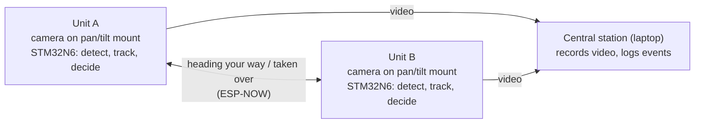

# Fall Project Proposal – Open Herd (Draft v1)

> **Draft (updated October 19, 2026).** Updated after the October 19 advisor check-in, which
> narrowed the scope to a security camera swarm. Nothing here is final. Hardware changes this use
> case implies are marked as **disclaimers** for the hardware team (Nader and Samuel) to decide.
> Section headings follow the EECS 159 proposal template.

## Names of Team Members, Team Member Role, UCI Email Addresses

Roles are carried over from SAFE-Swarm and may change for Open Herd.

1. Nader Guirguis, Hardware
2. Samuel Malak, Hardware
3. Devin Mccaw, Software
4. Aaron Torres, Software

UCI email addresses are left out of this copy because the repository is public.
Add them to the version you submit.

## Updated Project Information

**Faculty advisor:** Boris Vaisband

**Weekly check-in:** in person, Mondays (the team's Google Doc proposal says 11 AM; earlier notes said 6 PM; confirm)

## Updated Summary of Chosen Project

Open Herd keeps the two parts of SAFE-Swarm the team liked most, **onboard AI** and
**several small units working together**, but the units are fixed in place instead of flying.

The core idea is **modular hardware and AI**: one camera unit, built on the STM32N6 chip, that runs
its AI on the unit itself and can be reprogrammed for different jobs. Several identical units (same
hardware, same setup) talk to each other and coordinate on their own, as a swarm. The security
demo below is how we plan to show that.

What we want the design to stand for:

- **Modular and open.** The same unit runs different software for different jobs, and the plan is
  still to make it open source. Security is the demo;
  crowd monitoring and traffic counting are examples of later jobs.
- **Onboard decisions.** Each unit decides on its own when to track, where to turn, and when to
  hand off, following the advisor's October 19 advice to favor onboard processing over a central
  computer. The central station only records and logs.
- **Privacy-minded.** We plan no face recognition, no license plates, and no audio. Recordings
  stay on the owner's own station, not a third-party cloud. A retention limit and an access log
  are planned as later additions.

### The problem (draft)

A single security camera loses a person the moment they walk out of its view, and someone then has
to piece together footage from several cameras to follow what happened. In Open Herd, the cameras
make the tracking and handoff decisions themselves, each one passing the person to the next. The
central station only records, so the handoff is meant to keep working even if the recording side is
busy or stopped.

### Proposed approach (draft)

1. Several identical units are mounted around a property. Each sits on a mount that can turn (pan
   and tilt) and knows which neighbor covers which direction.
2. Every unit looks for people in its view, using AI on its own chip.
3. **Trigger:** when someone lingers suspiciously over the same area or item for too long, the unit
   starts tracking them. Spotting theft is a later goal (see the scope tiers below).
4. **Track:** the unit turns to keep the person near the center of its view.
5. **Hand off:** when the person leaves its view, the unit messages the neighbor on that side:
   "person heading your way."
6. **Pick up:** the neighbor turns toward that direction, picks up the person who appears there,
   replies that it has taken over. With a third unit (a should-have), it would warn its own
   neighbors in turn.
7. **Record:** each unit's video goes to a central station (a team laptop) that records it and keeps
   a log of every trigger and handoff.

The must-have demo covers this flow with two units.

Confirming that the neighbor picked up the *same* person by appearance (re-identification, which
compares overall appearance such as clothing; it isn't face recognition) is planned as the first addition once the basic handoff works.
ST's re-identification example supports the NUCLEO-N657X0-Q, the board the team reports buying, but
ST has only shown it working within a single camera.

### Use cases

The hardware stays the same across uses, and only the software changes.

| Use case | What the units would do | Status |
|---|---|---|
| Security and anti-theft swarm | Track a suspicious person and hand them off between cameras | **The demo** (chosen October 19) |
| Crowd monitoring | Count people in each camera's view and share the counts to spot bottlenecks | A later job for the same hardware |
| Traffic counting | Summarize foot or vehicle traffic | A later job for the same hardware |
| Plate alerts; drone piggyback (the same unit carried on a drone) | Ideas from earlier drafts | Set aside for now |

### Swarm behavior

For this project, "swarm" means the units coordinate with each other directly:

- Each unit knows its neighbors and which edge of its view leads to which neighbor.
- A unit that loses a person out the side tells that neighbor, which turns and gets ready before the
  person arrives.
- With three or more units, handoffs chain from unit to unit, and a unit that doesn't answer is
  flagged so the others carry on.

At the October 19 check-in, the advisor suggested reading up on swarm systems and working out an
algorithm for how the units coordinate on their own. That reading may change this design.

## Updated Visual Representation of Project

One possible layout of the demo. Nothing here is final.

The units decide what to do. The central station only records.

## Updated Major Tasks and Planned Workload Split

Template instructions: break milestones into weekly tasks, and assign each task to one
responsible member (split shared tasks into sub-tasks).

**Phase 1: dev board prototype (V0).** Use the STM32N6 development board the team reports buying
(NUCLEO-N657X0-Q, to be confirmed), plus a camera to be bought with school funding. The hardware plan uses ESP32 boards the
team already has for messages between units.

**Phase 2: custom board (V1).** Design the team's own PCB around the STM32N6. The goal is a board
that is cheaper, could be mass-produced, is easier to tune, and is probably smaller.

Areas of work. Leads are still to be assigned.

| Area | What it covers | Likely side (from current roles) | Lead |
|---|---|---|---|
| Dev board setup | Get the STM32N6 board running and build ST's example apps | Hardware and software | TBD |
| Camera | Choose and buy a camera ST supports (color likely suits appearance matching) and get images on the board | Hardware | TBD |
| Detection and tracking | Find and track people on the unit, building on ST's re-identification example | Software | TBD |
| Triggers | Detect loitering in a zone; later, a simple "item removed" check | Software | TBD |
| Pan/tilt follow | Turn the camera to keep the person in view (**new hardware, see disclaimers**) | Hardware and software | TBD |
| Handoff and coordination | Messages between units, neighbor pick-up, and handling a unit that drops out | Software | TBD |
| Central station | Record each unit's video and log events on a laptop | Software | TBD |
| Video link | How video gets from each unit to the central station (**see disclaimers**) | Hardware and software | TBD |
| Power and enclosure | Power for the board and servos; a case and mount | Hardware | TBD |
| Custom PCB (Phase 2) | Schematic, layout, and ordering the board | Hardware | TBD |

### Hardware changes this use case implies (disclaimers)

These come from the October 19 use case. The hardware team decides all of them.

- **Pan/tilt mount.** Each unit would need a pan/tilt mount with two small servos. Kits seen online
  run about $11.50–19 (snapshots, not checked at checkout). The software plan assumes only the camera
  board moves, so its ribbon cable would flex with every move. The hardware team decides the mounting.
- **Servo power.** Servos are usually powered from their own 5 V supply (about $8) that shares a
  ground with the board, rather than from the board itself.
- **Every unit needs its own board and camera.** Only one board is reported bought, and it most
  likely shipped without a camera. A two-unit handoff needs a second board (~$75) and two cameras;
  a chain needs three of each. A color camera probably suits appearance matching better than the
  black-and-white option.
- **Video to the central station.** Short messages between units fit on ESP-NOW, but video
  doesn't. The simplest V0 option is the USB webcam output from ST's example app (320x240) into a
  laptop, which keeps units within about 5 m of it. Whether two units can stream into one laptop at
  once still has to be tested. The Nucleo's Ethernet port or Wi-Fi are options for longer distances.
- **LoRa.** With ESP-NOW handling messages and USB, Ethernet, or Wi-Fi handling video, LoRa may not
  be needed. It could still serve as a backup alert link.
- **The custom board (V1).** For this use case, V1 would likely need a servo header, a 5 V servo
  supply, and a radio or Ethernet. That makes the hardware plan's ~$100-per-unit V1 target harder.
- **Where the demo runs.** The software schedule assumes the end-of-Winter demo runs on dev boards
  (V0), with running everything on the custom board as a software stretch goal. The hardware timeline
  (schematic draft in Week 5, a working V0 and V1 ordered by Week 10, Winter integration on the
  custom board) stays as the hardware team wrote it.
- **Cost.** The added parts put the rough Phase 1 estimate at about $160–190 per unit with a color
  camera, before power parts, cables, the case, tax, and shipping (more if LoRa is kept). This ties
  into the advisor's October 12 note to watch costs.

## Rough Parts List

See the [draft parts list](parts-list.md). In short: one STM32N6 board is reported bought. Each unit
needs its own board and camera. If the hardware team goes with this use case, each unit would also
need a pan/tilt mount with servos and a servo supply, plus an ESP32 for messages (some are on hand).
The central station can be a team laptop.

## Estimated Deliverables at Major Milestones

**Does this fit our time?** Probably, if we scale it down, and with little slack. At about 6 hours
per person per week, software has an estimated 148 hands-on hours across Fall and Winter after
meetings and write-ups. The must-have work below is estimated at about 135–145 hours, including extra
time for learning. It only fits if we build on ST's existing example for our board, freeze the
must-have list, and have cameras by about Fall Week 6 and pan/tilt kits by Week 7.

**Scope tiers**

- **Must have (the end-of-Winter demo):** two identical units on dev boards. Each finds and tracks a
  person on its own chip, starts tracking on loitering, turns to follow, and hands off to the other,
  which turns and picks the person up. A laptop records the video and logs every event.
- **Should have:** confirming the same person by appearance during a handoff; a third unit for a
  chain handoff; a simple "item removed" theft trigger; a recording viewer with automatic deletion
  and an access log; full measurements (frame rate, handoff delay, success rate).
- **Stretch:** video over Ethernet or Wi-Fi; AI-based theft detection; running everything on the
  custom board within Winter; using the extra sensors on ST's B-CAMS-IMX camera bundle (an IMU and a
  distance sensor), if that camera is chosen, in response to the advisor's "add sensors" note.

**Software plan (estimates)**

- **Fall Weeks 4–5:** install ST's tools and build its re-identification example; write the
  message format between units; get two ESP32s talking over ESP-NOW; submit the ZOT IRB
  self-determination with the advisor.
- **Fall Weeks 6–7:** camera running with person tracking on the board; servo control and a basic
  follow; the link from the board to its ESP32; the handoff state logic.
- **Fall Weeks 8–10:** a smoother follow; a first version of the central station that records and
  logs; a one-unit demo that tracks a person, follows them, and sends "heading your way" to a
  neighbor that turns.
- **Winter Weeks 1–3:** bring up the second unit with the same software; the loitering trigger; a
  full two-unit handoff (the must-have milestone).
- **Winter Weeks 4–6:** robustness checks; if the must-have is solid, add appearance confirmation
  and one more should-have.
- **Winter Weeks 7–10:** measurements, rehearsals, a backup recording of the demo, and the final
  report.

**Plan B:** if the two-unit handoff isn't working by Winter Week 4, drop every should-have and
finish the must-haves. The software plan already targets dev boards for the demo, so a late custom
board doesn't block it. This follows
the advisor's October 12 note to have a backup plan.

## Open Questions

- **Swarm algorithm:** What coordination approach do we use? (October 19 action: read up on swarm systems.)
- **Sensors:** Which extra sensors, if any? One of ST's camera bundles (B-CAMS-IMX) includes an IMU and
  a distance sensor; we haven't checked whether ST's examples for our board use them.
- **Onboard vs. central:** The advisor favors onboard processing. Is recording at a central station
  still okay, or should units keep their own clips?
- **Theft:** Is a simple "item removed from a zone" check enough, or does the demo need real theft detection?
- **Appearance matching:** Can a unit reliably recognize the same person seen by a different
  camera? ST has only shown this within one camera, so we'd need to measure it ourselves.
- **Video link:** USB to a laptop for V0, or Ethernet or Wi-Fi? (Hardware decision.)
- **Units:** How many units can the budget cover: two for a handoff, or three for a chain?
- **Cameras:** Stock varies by store, and one listed a very long lead time. Order early from a store that shows real stock.
- **Location:** Do units need GPS, or is each unit's position and neighbor list set at install?
- **IRB and recording rules:** Testing on people likely needs a ZOT IRB self-determination (with the
  advisor) first. No microphones: California requires all-party consent to record confidential
  conversations (Penal Code 632). This is general information, not legal advice.
- **Check-in time:** Monday at 11 AM or 6 PM?

## Additional Comments / Advisor Feedback

- **Earlier comments (in the proposal):** interesting idea, keep planning; make a rough timeline,
  initial budget, and task breakdown (done).
- **October 12 (first meeting):** watch the costs so the budget doesn't balloon, and have a backup
  plan because the project is complex.
- **October 19:** narrow the scope to identical camera units that coordinate as a swarm; read up on
  swarm systems; consider more sensors; work out a coordination algorithm; favor onboard processing
  over a central computer.

Full notes are in the [meeting notes](meeting-notes.md). Feedback on SAFE-Swarm is in the
[legacy proposal](../legacy/EECS%20159%20-%20Project%20Proposal.pdf).
