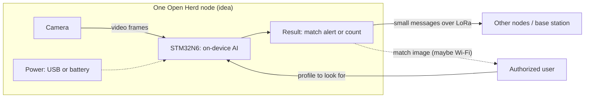

# Fall Project Proposal – Open Herd (Draft v0)

> **Day-0 draft (October 16, 2026).** The team just switched from SAFE-Swarm to Open Herd.
> This draft was written from a brainstorm list, a team chat, and a voice memo. Nothing in it
> is agreed yet, and some of it may not match what the team meant. Correct anything that's off.
> Section headings follow the EECS 159 proposal template.

## Names of Team Members, Team Member Role, UCI Email Addresses

Roles are carried over from SAFE-Swarm and may change for Open Herd.

1. Nader Guirguis, Hardware
2. Samuel Malak, Hardware
3. Devin Mccaw, Software
4. Aaron Torres, Software

UCI email addresses are left out of this copy because the repository is public.
Add them to the version you submit.

## Updated Project Information

**Faculty advisor:** Boris Vaisband (carried over from SAFE-Swarm; confirm he's okay with the switch)

**Weekly check-in:** in person, Mondays at 6 PM (carried over; tentative)

## Updated Summary of Chosen Project

Open Herd keeps the two parts of SAFE-Swarm the team liked most, **onboard AI** and
**several small units working together**, but the units are fixed in place instead of flying.

The proposed product is a standalone camera device ("node") that runs AI on the device itself.
The same hardware could run different software builds for different customers and uses.
The two main selling points in the team's notes are:

- **Privacy first.** Video is processed on the node and then discarded. No footage is stored.
  Nothing leaves the node unless there is a match (for the security use) or a summary such as
  a count (for crowd or traffic uses).
- **Modular and open.** The plan is to make it open source and expandable to whatever a
  customer needs, which could also make it easier to commercialize.

### The problem (draft)

The team's notes say many people feel networked surveillance cameras, such as Flock's
license-plate cameras used by police, violate their privacy. Concerns in the notes include:

- Images and video going to third-party companies the public doesn't know about
- Police being able to access the cameras or their data at any time
- Someone with access misusing it, for example to follow a specific person
- Every passer-by being checked against large databases

These are the team's concerns, not checked facts about Flock. Before the proposal makes claims
about any company, check them against sources. (To research.)

### Proposed approach (draft)

For the security use case, the voice memo describes this flow:

1. An authorized user, such as a police department, sends a "profile" to the nodes. The memo
   suggests it could contain a name, a photo, an age range, and maybe a license plate number.
2. Each node compares the faces or cars it sees against that one profile, on the device.
3. On a match, the node sends an alert with its location and one image, so a person can check
   whether it's really a match.
4. Apart from that one image, nobody gets live or stored access to the footage.

The team chat describes the difference from Flock this way: a local model compares what the
camera sees to a single image provided by police, instead of sending images to an outside
company that checks them against a large database.

### Use cases

In the chat, the idea is that the hardware stays the same across uses and only the software changes.
Which use becomes the demo isn't decided. In the chat, the team leaned toward the
security use ("our version of Flock") as the demo, with the others shown as future applications.

| Use case | What the node would do | Notes from the discussion |
|---|---|---|
| Privacy-first security alert | Match faces or plates against one profile; alert only on a match | Seen as the strongest pitch by some of the team |
| Crowd safety at venues (games, concerts) | Count people to estimate the risk of crowd crush or problems in an emergency | Raised as a use case in the notes |
| Traffic | Summarize foot or vehicle traffic; for example on a busy highway (pitched to a maps company) or around a school (how crowding relates to building layout) | One concern raised: traffic monitoring already exists, and privacy matters less there unless faces are scanned |
| Evacuation / crowd control | Listed in the brainstorm | Not discussed further yet |
| General research platform | A base device that others can program for their own studies | One view in the chat: the main research goal is this base platform itself |

### Swarm behavior

The brainstorm keeps "swarm behavior" as a core premise. What it means for fixed nodes hasn't
been defined. Some possibilities, all just ideas:

- Nodes share alerts or counts with each other over LoRa
- Counts from several nodes are combined to cover a larger area
- A profile sent to one node is passed on to nearby nodes

## Updated Visual Representation of Project

One possible layout of a single node, based on the brainstorm's hardware list. Nothing here is decided.

Video frames stay inside the node. Only the result leaves it.

## Updated Major Tasks and Planned Workload Split

Template instructions: break milestones into weekly tasks, and assign each task to one
responsible member (split shared tasks into sub-tasks).

**Not done yet.** Weekly tasks and owners still need to be set by the team. What the notes
describe so far:

**Phase 1: dev board prototype.** Use the STM32N6 development board the team bought, plus
a camera. The camera would be bought with school funding.

**Phase 2: custom board.** Design the team's own PCB around the STM32N6. The goal is a board
that is cheaper, could be mass-produced, is easier to tune, and is probably smaller.

When each phase starts and ends isn't decided.

The brainstorm's hardware list points to these areas of work. They aren't assigned or scheduled.

| Area | What it covers | Likely side (from current roles) | Lead |
|---|---|---|---|
| Dev board setup | Get the STM32N6 board running and run an example | Hardware and software | TBD |
| Camera | Choose a CSI-2 (MIPI) or parallel camera, buy it, get images | Hardware | TBD |
| On-device AI | Pick or train a model for the demo use case; measure speed and accuracy | Software | TBD |
| LoRa and swarm | Pick a LoRa module; send messages between nodes; define "swarm" behavior | Hardware and software | TBD |
| Power | USB power vs a battery for off-grid use | Hardware | TBD |
| Enclosure | A case for the node | Hardware | TBD |
| Demo software | Profiles, match alerts or counts, and the privacy rules | Software | TBD |
| Custom PCB (Phase 2) | Schematic, layout, and ordering the board | Hardware | TBD |

## Rough Parts List

See the [draft parts list](parts-list.md). In short: the STM32N6 board is bought, and the
camera, LoRa module, power parts, maybe a Wi-Fi module, and an enclosure still need to be chosen.

## Estimated Deliverables at Major Milestones

Not set yet. The team still needs to agree on the demo use case and the phase timing first.

Possible first checkpoints to discuss (not scheduled):

- Run one of ST's example AI programs on the STM32N6 board
- Get images from the chosen camera on the board
- Send a message from one LoRa module to another

## Open Questions

- **Advisor:** Is Prof. Vaisband okay with the switch? Does the new scope fit the course?
- **Demo:** Which use case is the demo?
- **Swarm:** What does "swarm behavior" mean for fixed nodes, and how many nodes does the demo need?
- **Camera:** CSI-2 (MIPI) or parallel? (To research.)
- **Images over LoRa:** LoRa is built for small messages, so sending a match image may need Wi-Fi or something else. (To research.)
- **Power:** USB only, or battery for off-grid use?
- **Location:** Is each node's location entered at install, or does it need GPS?
- **AI models:** Which models for face matching, plate reading, or people counting can run on the STM32N6? (To research.)
- **Privacy design:** Which profile fields does a node actually need? How long does a profile stay on a node? Who is allowed to send one, and how is that checked?
- **Accuracy:** Face matching can make mistakes, and a false match could hurt someone. How will the team measure and limit that?
- **Law and ethics:** Face recognition and license plate readers are regulated in some places. Testing on people may need their consent and possibly university review. Discuss with the advisor. (To research.)

## Additional Comments / Advisor Feedback

No advisor feedback on Open Herd yet. Feedback on SAFE-Swarm is in the
[legacy proposal](../legacy/EECS%20159%20-%20Project%20Proposal.pdf).
